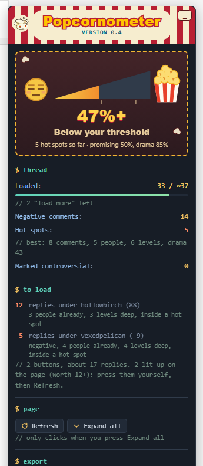

# SRD Helper

A userscript that finds the drama in a Reddit thread. On old.reddit it rates how much of the thread is fighting
(the Popcornometer), marks the hot spots on the page, and exports the thread for Kettle, the Windows app that turns it
into a quote-chain post. Also a small readout on new reddit and a ranked list on subreddit pages.

## Install
1. Install a userscript manager in your browser: **Tampermonkey** or **Violentmonkey**.
2. Open [srd-helper.user.js](https://raw.githubusercontent.com/dontdoubtdusty/srd-helper/main/srd-helper.user.js).
   The manager shows an install page.
3. Press **Install**.

Updates: the manager checks for new versions by itself. The panel header shows the version you have.

Uninstall: remove SRD Helper in the manager's dashboard. It keeps nothing else.

## Usage
Open a thread on old.reddit.com; the panel appears. It shows the drama percentage with a line on why and the "load
more" buttons worth pressing; on the page, the hot spots are marked and those buttons are lit up for you.
**Expand all** opens collapsed comments. **Export for app** downloads `srd-<thread id>.srd.json` for Kettle
(`kettle/README.md`). On new reddit you get an estimate and a button that opens the thread on old.reddit, sorted by
controversial. The full guide, with pictures, is in Kettle (press **F1**) or `kettle/resources/guide/GUIDE.md`.

## Known limits
- Read-only on purpose: it reads the page you have open, makes no requests and never clicks, scrolls or loads anything
  for you. The one exception is **Expand all**, and only when you press it.
- Scores come from the comments loaded on the page. Unloaded replies are not counted, so press the lit "load more"
  buttons before trusting the number.
- A fresh thread reads low until votes settle.
- The meter judges fighting, not whether the fight is about the post. An off-topic argument can rank high.
