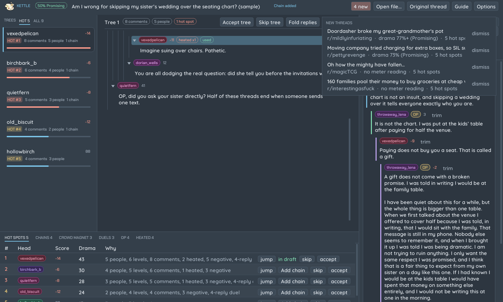

# Kettle

A Windows app for writing up Reddit drama as a quote-chain post. It opens threads exported by the SRD Helper
userscript, shows where the fights are, and builds the post with you. Hot spots ranked by drama, one comment tree at a
time, a draft with a username badge on every quote, trimming, headers, a template, and a New threads list that picks up
fresh exports by itself.

## Install
There is no download yet; Kettle runs on the owner's PC only.
1. Install the .NET 10 runtime if Windows asks for it.
2. Double-click **Build Kettle.bat** in the `kettle` folder. It makes the app in `GitHub\Kettle`.
3. Start **Kettle** from the Desktop or the Start menu.

Updates: run **Build Kettle.bat** again (close Kettle first).

Uninstall: delete the `GitHub\Kettle` folder, the two Kettle shortcuts, and `%AppData%\Kettle` (settings, drafts and
opened threads).

## Usage
On an old.reddit thread, press **Export for app** in the SRD Helper panel. Then open the file in Kettle: drag it onto
the window, press **Open file...**, or pick it from **New threads**. To have new exports listed for you, add your
Downloads folder under **Options** > **Watched folders**; Kettle checks it every 10 seconds, sorts new threads by
drama, and moves a file into its own folder when you open it. Start on the hot spots (the top 5; **Show all** shows
the rest), press **Add chain** on the good ones, arrange them under headers, then press **Copy** and paste the post.
Drafts save by themselves and come back when you open the same thread again. Press **F1** for the full guide.

| Key | Action |
|---|---|
| F1 | Open or close the guide |
| Alt+Z | Undo the last draft change |
| Alt+Shift+Z | Redo |

## Known limits
- Windows only. Not signed, and no release build yet.
- Emoji and Chinese, Japanese or Korean text show as `?`.
- No file association: use drag and drop, **Open file...** or New threads.
- Kettle never talks to Reddit, on purpose. It only reads files you exported; the links it opens go to your browser.
- Opening a thread from New threads moves the file out of the watched folder into `%AppData%\Kettle\threads`.
