# SRD Desk guide

## Welcome
>  Hi, I'm Poppy! I'll be your guide. Look out for me: I pop up wherever there is something worth knowing.

SRD Desk helps you build a quote-chain post (an "SRD" post) from a Reddit thread. The work is split in two halves:

- The SRD Helper userscript runs in your browser. On old.reddit.com it reads the thread you already have open, scores every comment for drama, lights up the hot spots and exports the whole loaded thread to a file. On new reddit it shows a quick estimate and a button to open the thread in old reddit.
- SRD Desk (this app) opens that file. It starts on the hot spots; you pick chains, arrange them under headers, and copy the finished markdown.

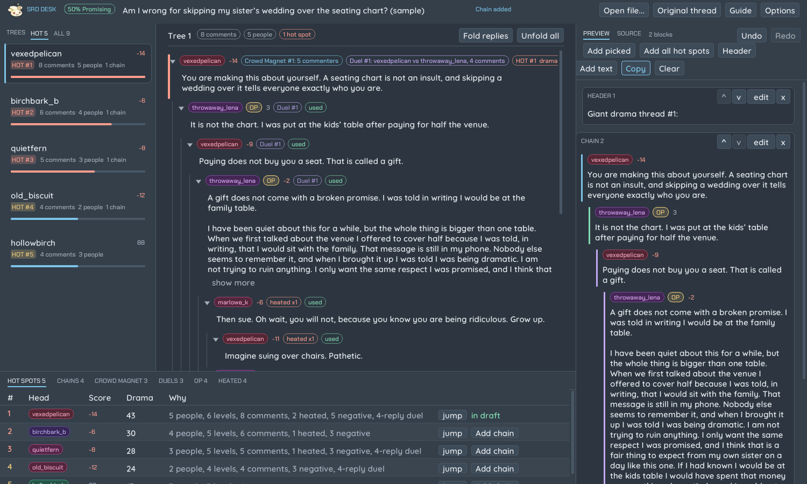

> 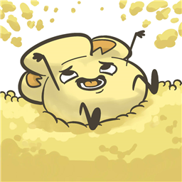 Everything here is read-only toward Reddit. The userscript only reads the page that is already open, and this app never goes online at all. Nothing is posted for you and nothing is fetched. You do the posting. Now, who wants popcorn?

The pages on the left follow the order you will use them: Quick start, then the browser side, the app, the post format, the tags and the meter, tips, and Options.

## Quick start
This walks through the sample thread that ships with the app (an invented argument about a wedding seating chart), so you can follow along without Reddit. The file is `samples\example.srd.json`.

1. Start SRD Desk. You see the welcome screen.
2. Press Open file... and choose `samples\example.srd.json` (or drag the file onto the window).
3. The thread opens on its best hot spot. The meter chip in the top bar says 50% Promising. The list on the left shows the five trees that hold a hot spot, best first (ALL shows all nine).
4. Press Header, then Giant drama thread #1: at the top of the menu. The header line appears in the draft on the right.
5. At the bottom, the Hot spots tab lists where the fights are. Press Add chain on row 1. The main line of that fight becomes a chain in the draft, under the header, with the last quote as the link.
6. Press Header again and choose Subthread 1:, then Add chain on another row. Or press Add all hot spots to add every one at once.
7. Press Copy. The whole post is on your clipboard as markdown. Paste it into Reddit.

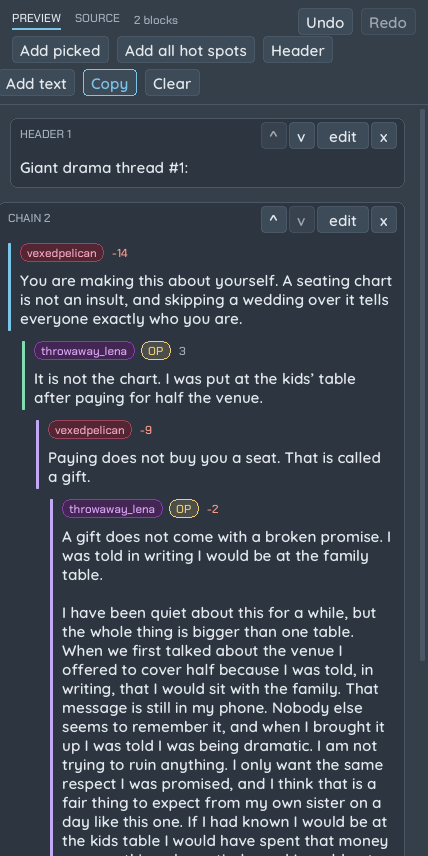

> 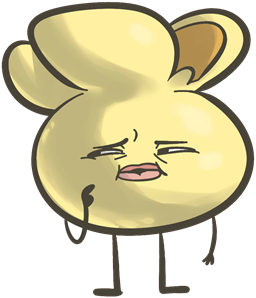 Hmm, where are the usernames? The ones in the draft are only for you. They are not in the copied text, because the post format has no usernames. Press the Source tab to see exactly what you will paste.

## In the browser
Install the userscript in a userscript manager such as Tampermonkey or Violentmonkey, from its GitHub page (`dontdoubtdusty/srd-helper`, file `srd-helper.user.js`). Installed that way, the manager checks GitHub for new versions and offers them; the panel shows which version you have.

On old.reddit.com every thread gets the full panel at the right edge. On new reddit (www.reddit.com) a thread gets a small readout instead: see below.

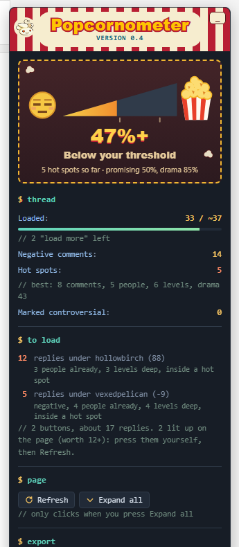

### The panel (old reddit)
- **Popcornometer:** the thread's drama rating, as a percentage and a verdict. See the Tags and the meter page.
- **Thread:** how many comments are loaded, how many are negative, how many hot spots were found and the best one.
- **Drama mode:** Reopen in drama mode opens the same thread in a new tab, sorted by controversial with up to 500 comments loaded. When the page already is in drama mode, the button turns green and says so.
- **To load:** a read-only list of the "load more comments" buttons still on the page, the ones worth pressing first. A button is worth pressing when the replies it hides sit under a comment that is already a fight: a negative, controversial or heated comment, one with three or more people or three or more levels below it, or one inside a hot spot. Each row says why. The worthwhile buttons (worth 12 or more, at least 3 replies; `loadMoreWorth` at the top of the userscript) are lit up in bright yellow and pink on the page. The panel never scrolls or clicks for you; find the lit button and press it yourself, then press Refresh.
- **Refresh:** read the page again (it also happens by itself when the page changes).
- **Expand all:** opens collapsed comments so they can be read. It only clicks when you press it, once per collapsed comment, and it never presses "load more".
- **Export for app:** downloads a file named `srd-` plus the thread id, ending in `.srd.json`. This is what SRD Desk opens. It holds the whole loaded thread with a drama score on every comment, the hot spots, the category winners and the meter result.

If something goes wrong while reading the page, a red box at the top of the panel says what happened, instead of the panel quietly showing old numbers.

> 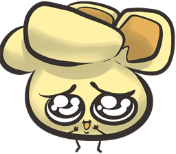 Please be careful with the exported file. It is just text you can open in Notepad, but it holds public comment text and usernames from the page you exported, so treat it like a copy of the page.

### What the page highlights
The hot spots (see Tags and the meter) are marked on the page itself, each with a small HOT badge and its drama score:
- **#1 to #3:** a thick red edge and a red tint over the whole fight.
- **#4 to #10:** an orange edge and tint.
- **#11 to #15:** a thin amber edge.

Comments Reddit marks as controversial get a dashed purple outline.

### New reddit
New reddit loads only part of a thread and hides most downvoted replies, so it gets a quick readout: the Popcornometer with an ESTIMATE stamp, the comment counts, and one big button, **Open in old reddit**. The button opens the same thread on old.reddit.com in a new tab, sorted by controversial with up to 500 comments, which is the best starting point for the full panel. It opens a tab only when you click it; the script never redirects you by itself.

## In the app
### Opening a thread
Drag a `.srd.json` file onto the window, press Open file..., or pass it on the command line. Recently opened files are listed on the welcome screen. If you re-export the same thread later, the draft you made for it comes back, because drafts are saved per thread.

### The layout
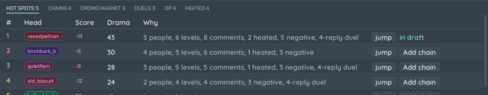

- **Top bar:** Poppy, the meter result, the thread title (hover it to see the whole title), a status message, Open file..., Original thread, Guide and Options.
- **Trees (left):** HOT lists the trees that hold a hot spot, best first; ALL lists every tree in thread order (a whole thread can have hundreds). Each card shows the top commenter, their score, the best hot spot in it, the size and the number of people. Click a card to open it.
- **Thread (middle):** the selected tree, nested. The arrow folds a comment. Usernames are colored badges, the same color for the same person everywhere. Scores are small, and red when negative. A hot spot starts with a HOT chip and a colored edge (red for the top three). A comment that is already in your draft shows a green "used" chip.
- **Console (bottom):** tables of what was found. Hot spots comes first: rank, who started it, the drama score and what it is made of. Each row has a jump button that scrolls the thread to that comment, and Add chain (or "in draft" once it is there).
- **Draft (right):** your post in the making.

### Picking comments
Hover a comment to see its controls.

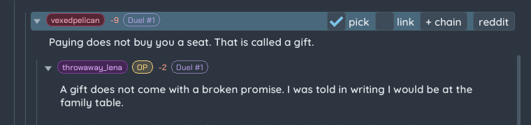

- **+ chain:** adds the main line of replies starting at this comment as one chain. The main line follows the reply with the deepest branch at each level, up to the chain length limit (6 normally; you can change it in Options).
- **pick:** ticks the comment. Then press Add picked in the draft panel to add all ticked comments as one chain, in thread order.
- **link:** makes that quote a link to the comment on Reddit too. If you tick link on no quote, the last quote of the chain becomes the link (it is usually the punchline); if you tick link on any quote, only the ticked ones are linked. Linking also ticks pick.
- **reddit:** opens the comment on Reddit in your browser.

Press Add all hot spots in the draft panel to add every hot spot that is not in the draft yet, best first (in older files without drama scores the button says Add all chains and uses the chains). A chain whose first comment is already in the draft is skipped.

### The draft
Each piece of your post is a card. Buttons on the card: ^ and v move it, edit opens its markdown, x removes it. Edit a chain by hand and the card is marked "edited", and the preview stops showing usernames, because the names can no longer be matched to the lines.

- **Header:** adds a header line at the end of the draft, plain by default. The popup starts with two numbered headers, Giant drama thread #N: and Subthread N: (the numbers count what is already in the draft, and Subthread starts again at 1 under each giant thread). Below them are your presets (click to add; B makes that preset bold or plain; x removes it), a Custom header box (what you type is added and remembered), a bold box for custom and numbered headers, and the template buttons. To switch a header in the draft between bold and plain, press edit on it and tick bold. Add the header first, then the chains that belong under it, then the next header.
- **Add text:** a free text block for your own sentences.
- **Preview / Source:** Preview shows the cards with badges. Source shows exactly the markdown that Copy puts on your clipboard.
- **Undo and Redo:** the buttons at the top right of the draft (Alt+Z undoes, Alt+Shift+Z redoes). They cover every change to the draft: adding, removing, moving, editing and clearing. Typing in a card counts as one step per edit. The history is kept while the thread is open, not after you close the app.
- **Copy:** copies the whole post. It also writes a small labels file next to the draft (`drafts\<thread id>.labels.json`) listing which comments you used and their drama scores; see Tips. **Clear** empties the draft after asking.

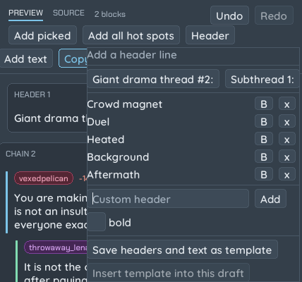

### The template
The template is your usual skeleton. Build the headers and text blocks you always use, then press Save headers and text as template. Every new draft starts with them. Chains are not part of the template. Insert template into this draft adds it to a draft you already have.

## The post format
The copied text is the standard SRD layout.

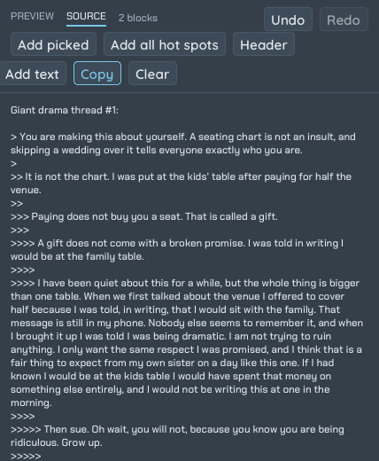

- Each quote is a Reddit quote line. The first comment of a chain starts with `>`, a reply to it with `>>`, a reply to that with `>>>`, and so on. A `>` on its own line separates quotes.
- When a chain starts on a reply, the comment it replies to is quoted first, plain and without a link, so readers know what started it. The preview shows it grayed with a "replying to" chip. It does not count as used. Turn it off in Options.
- The last quote of a chain is the link, unless you ticked link on another quote in it. A linked quote is one line: the whole comment text becomes the link text, `[the comment](https://www.reddit.com/...)`. Paragraphs of a linked comment are joined into one.
- An unlinked quote keeps its paragraphs, each on its own quote line.
- Chains are separated by a line with a single `*`, an empty bullet. That keeps each chain a separate block on Reddit.
- A header is a plain line, `Giant drama thread #1:`, with a blank line around it, or a bold one, `**Like this**`, if you chose bold.
- Your own text blocks are plain paragraphs.
- Usernames are never in the output.

> 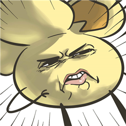 If the app and the userscript ever build different text for the same chain, that is a bug, and I will be very cross. The app builds a chain the same way as the userscript, down to the byte.

## Tags and the meter
### Drama scores and hot spots
Every comment gets a drama score for itself and the replies under it. It goes up with:
- how many levels deep the replies go, how many different people take part, and how many comments there are;
- heated comments (see below), comments Reddit marks controversial, and negative comments (more for deeper negatives);
- a long back-and-forth between two people;
- six or more replies within one hour;
- replies still hidden behind "load more" (a little).

A score on its own favors big trees, so the hot spots are picked differently: a fight counts as one hot spot when it scores higher as a whole than its separate branches would together; otherwise its branches compete on their own. The 15 best are ranked HOT #1 to #15. A hot spot needs at least three levels, two people and four comments. The weights are `DRAMA` at the top of the userscript.

### Chains
A chain is the older, stricter rule, still shown in its own tab: a negative comment with several levels of replies and at least two people in it. The Chains tab in the console lists them with the head comment, its score, the number of levels, the number of comments and the number of people.

### The tags on comments
- **Crowd Magnet:** a comment whose replies hold the most different people (at least three). The three best that do not overlap are marked, for example "Crowd Magnet #1: 5 commenters".
- **Duel:** the longest back-and-forth between exactly two people, at least four comments. Heated comments inside a duel count for extra when duels are ranked.
- **heated xN:** the comment contains N words or phrases from a list of heated words (insults, "grow up", "touch grass" and so on). The list lives in the userscript and you can edit it.
- **OP:** the comment is by the original poster. The OP tab lists their comments.

### The meter
The Popcornometer adds up the drama scores of the hot spots and turns the total into a rating, so you can tell at a glance if a thread is worth it. It rises quickly at first and levels off near 100%, so one huge thread cannot run away with it.

| Rating | Verdict |
|---|---|
| under 50% | Below your threshold |
| 50% to 84% | Promising |
| 85% to 100% | DRAMA-FILLED |

It was set so the example threads land where they felt right (the PCM rules thread and the antiwork thread in the 90s, the Chappelle thread around 80% from its partial export). The rating is only given when the thread can be judged: at least 20 comments loaded, and most scores visible. A percentage with a plus sign, such as 55%+, means more comments are still unloaded, so it can only go up. On new reddit it is always an estimate.

## Tips
### Mouse
- Click the arrow next to a comment to fold it. Fold replies and Unfold all (above the thread) do it for the whole tree.
- Click show more under a long comment to read all of it, and show less to shorten it again.
- Hover the row of a comment to see pick, link, + chain and reddit.
- The jump buttons in the console scroll the thread to a comment and flash its row.
- Drag a thread file onto the window to open it.

### Keyboard
- F1 opens and closes this guide.
- Alt+Z undoes the last change to the draft, Alt+Shift+Z redoes it. It is ignored while you type in a text box.
- Click outside the Header menu to close it. Options has a Close button.
- In the Custom header box, Enter adds the header.

### Habits that help
- Add the header first, then its chains, so the order in the draft is already right.
- Use Add all hot spots early, then delete the chains you do not want. It is quicker than adding one by one.
- Start from new reddit? Press Open in old reddit in the readout, then Expand all and the lit-up load more buttons before you export.

### Teaching the drama score
Every time you press Copy, the app writes which comments the post links next to the draft. `calibrate.js` in the userscript folder compares those (or a finished post saved from your browser) with the drama scores and reports how many of your picks were inside a hot spot and how high they ranked. Run it after changing the weights in `DRAMA` to see whether a change helps:

`node calibrate.js srd-abc123.srd.json drafts\abc123.labels.json`
- Edit a chain only when you must. Hand edits turn off the usernames in the preview for that card.
- Keep a template for the headers you always use, and add the custom ones as you go.

## Options
Open Options from the top bar. Changes apply at once and are saved.

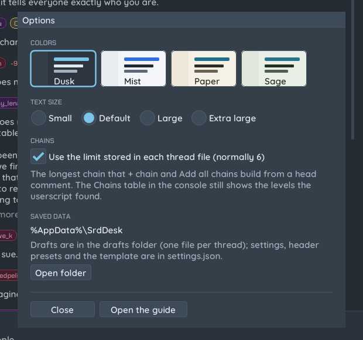

- **Colors:** four schemes. Dusk is the default dark one; Mist, Paper and Sage are light.
- **Text size:** Small, Default, Large or Extra large.
- **Chains:** the longest chain that + chain and Add all chains will build. By default it uses the limit stored in each thread file, normally 6. The Chains table in the console is unaffected, since the userscript works it out. **Show what the chain replies to** (on by default) puts the parent comment on top of chains that start on a reply.
- **Saved data:** where drafts, presets and the template are kept (`%AppData%\SrdDesk`), with a button to open the folder.

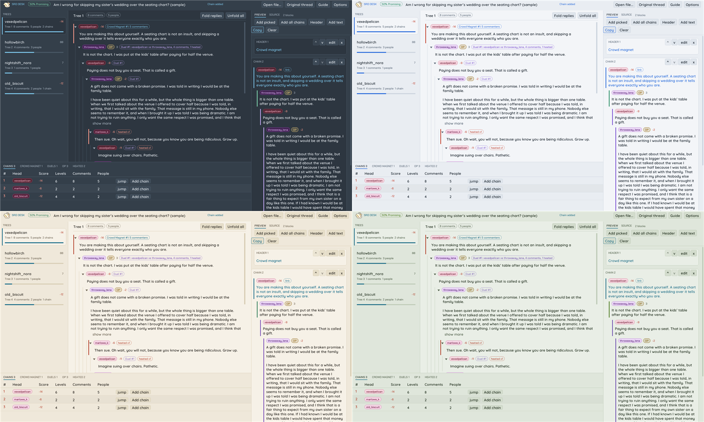

>  That's everything. Press F1 any time to find me again.
